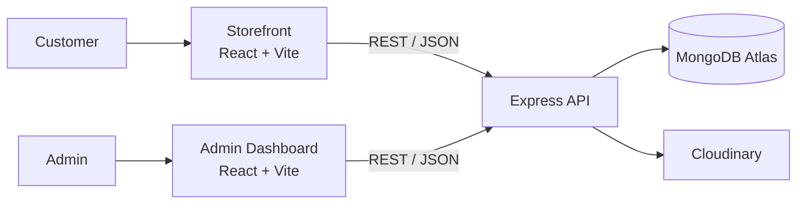

<div align="center">

# 🛍️ ForeverShops

**A full-stack MERN e-commerce platform with a customer storefront and a dedicated admin dashboard.**

[](https://react.dev/)
[](https://vitejs.dev/)
[](https://tailwindcss.com/)
[](https://nodejs.org/)
[](https://expressjs.com/)
[](https://www.mongodb.com/atlas)
[](https://cloudinary.com/)
[](https://jwt.io/)
[](https://opensource.org/license/isc-license-txt)


</div>

---


## 📑 Table of Contents

- [Overview](#-overview)
- [Features](#-features)
- [Tech Stack](#-tech-stack)
- [Architecture](#-architecture)
- [Project Structure](#-project-structure)
- [Getting Started](#-getting-started)
- [Environment Variables](#-environment-variables)
- [API Reference](#-api-reference)
- [Deployment](#-deployment)
- [Performance Notes](#-performance-notes)
- [Roadmap](#-roadmap)
- [Contributing](#-contributing)
- [License](#-license)

## 🔎 Overview

ForeverShops is a three-tier clothing e-commerce application:

| Package | Purpose | Default Port |
| --- | --- | --- |
| `Frontend/` | Customer-facing storefront (browse, search, cart, checkout, orders) | `5173` |
| `admin/` | Admin dashboard (product and order management) | `5174` (Vite auto-increments) |
| `Backend/` | REST API, authentication, persistence, media handling | `4000` |

## ✨ Features

**Storefront**
- Product catalogue with category and sub-category filters, keyword search and price sorting
- Product detail pages with size selection, image gallery and related products
- Persistent per-user cart synced to the database
- Cash on Delivery checkout and order history
- JWT-based registration and login
- Skeleton loaders, lazy-loaded images and a cached product list for fast perceived load

**Admin Dashboard**
- Secure admin login
- Add products with up to four images (uploaded to Cloudinary)
- List and remove products
- View all orders and update fulfilment status

**Backend**
- RESTful API with Express 5 and Mongoose 8
- Role-protected routes via JWT middleware (`auth`, `adminAuth`)
- `bcrypt` password hashing, `validator` input checks
- Seed and migration scripts for bulk product import and image migration to Cloudinary

## 🧰 Tech Stack

| Layer | Technologies |
| --- | --- |
| Frontend | React 19, React Router 7, Vite 7, Tailwind CSS 3, Axios, React-Toastify |
| Admin | React 19, React Router 7, Vite 6, Tailwind CSS 4, Axios, React-Toastify |
| Backend | Node.js (ES Modules), Express 5, Mongoose 8, JWT, bcrypt, Multer |
| Database | MongoDB Atlas |
| Media | Cloudinary (`multer-storage-cloudinary`) |
| Hosting (suggested) | Netlify (frontend/admin), Render (API) |

## 🏗️ Architecture



## 📁 Project Structure

```text
ForeverShops/
├── Backend/
│   ├── config/          # MongoDB and Cloudinary setup
│   ├── controllers/     # user, product, cart, order logic
│   ├── middleware/      # auth, adminAuth, multer
│   ├── models/          # Mongoose schemas
│   ├── routes/          # Express routers
│   ├── seedAssets.js    # Seed products from Frontend assets
│   ├── migrateImages.js # Migrate local images to Cloudinary
│   └── server.js
├── Frontend/            # Customer storefront
│   └── src/{components,context,pages,assets}
└── admin/               # Admin dashboard
    └── src/{components,pages}
```

## 🚀 Getting Started

### Prerequisites

- Node.js 18+ and npm
- A MongoDB Atlas cluster (or local MongoDB)
- A Cloudinary account (optional for local development)

### 1. Clone

```bash
git clone https://github.com/Niveditha-Sury/ForeverShops.git
cd ForeverShops
```

### 2. Backend

```bash
cd Backend
npm install
cp .env.example .env      # then fill in your values
npm run server            # nodemon on http://localhost:4000
```

Optional: seed the database with the sample catalogue.

```bash
node seedAssets.js
```

### 3. Storefront

```bash
cd Frontend
npm install
cp .env.example .env
npm run dev               # http://localhost:5173
```

### 4. Admin Dashboard

```bash
cd admin
npm install
cp .env.example .env
npm run dev
```

## 🔐 Environment Variables

**`Backend/.env`**

| Variable | Description |
| --- | --- |
| `PORT` | API port (default `4000`) |
| `MONGODB_URI` | MongoDB connection string (the `/e-commerce` database name is appended automatically) |
| `JWT_SECRET` | Secret used to sign tokens |
| `ADMIN_EMAIL` / `ADMIN_PASSWORD` | Admin dashboard credentials |
| `CLOUDINARY_NAME` | Cloudinary cloud name |
| `CLOUDINARY_API_KEY` | Cloudinary API key |
| `CLOUDINARY_SECRET_KEY` | Cloudinary API secret |

**`Frontend/.env` and `admin/.env`**

| Variable | Description |
| --- | --- |
| `VITE_BACKEND_URL` | Base URL of the API, e.g. `http://localhost:4000` |

> ⚠️ Never commit real `.env` files or credentials. Use `.env.example` with placeholders only.

## 📡 API Reference

Base path: `/api`. Protected routes expect a `token` header.

| Method | Endpoint | Auth | Description |
| --- | --- | --- | --- |
| `POST` | `/user/register` | – | Create a customer account |
| `POST` | `/user/login` | – | Customer login |
| `POST` | `/user/admin` | – | Admin login |
| `GET` | `/product/list` | – | List all products |
| `POST` | `/product/single` | – | Get a single product |
| `POST` | `/product/add` | Admin | Add a product (multipart, `image1`–`image4`) |
| `POST` | `/product/remove` | Admin | Remove a product |
| `POST` | `/cart/get` · `/cart/add` · `/cart/update` | User | Manage the user cart |
| `POST` | `/order/place` | User | Place a COD order |
| `POST` | `/order/userorders` | User | Order history |
| `POST` | `/order/list` · `/order/status` | Admin | All orders / update status |
| `GET` | `/health` | – | Liveness probe (served at the server root, not under `/api`) |

## ☁️ Deployment

- **Backend (Render):** set the root directory to `Backend`, build command `npm install`, start command `npm start`, and add all backend environment variables.
- **Storefront and Admin (Netlify):** set the base directory to `Frontend` or `admin`, build command `npm run build`, publish directory `dist`, and set `VITE_BACKEND_URL` to your deployed API URL. SPA redirects are already configured via `public/_redirects`.
- **Free-tier tip:** free Render instances sleep after inactivity. Point an uptime monitor (e.g. UptimeRobot) at `/health` every 5–10 minutes to avoid cold-start delays.

## ⚡ Performance Notes

- `GET /api/product/list` uses `.lean()`, sorts by newest and sends `Cache-Control` headers.
- The storefront caches the last product list in `sessionStorage` and revalidates in the background.
- Skeleton loaders replace blank grids while products load.
- Cloudinary images are requested with `f_auto,q_auto` and a capped width; below-the-fold images are lazy-loaded.

## 🗺️ Roadmap

- [ ] Online payments (Stripe and Razorpay SDKs are installed but not yet wired up)
- [ ] Server-side pagination and search
- [ ] Product reviews and ratings
- [ ] Automated tests and CI pipeline
- [ ] Rate limiting and request validation hardening

## 🤝 Contributing

1. Fork the repository
2. Create a feature branch: `git checkout -b feat/your-feature`
3. Commit using conventional messages: `git commit -m "feat: add your feature"`
4. Push and open a Pull Request

## 📄 License

Distributed under the ISC License.

<div align="center">

Built by [Niveditha Sury](https://github.com/Niveditha-Sury)

</div>